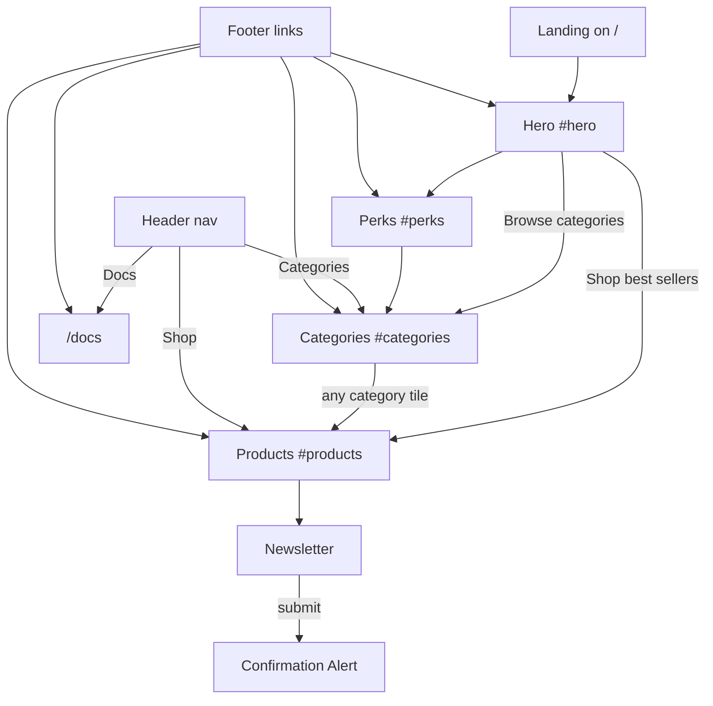

# Website flow: Home / storefront

Module by module flow of the home page (`/`). Update it when sections, anchors or links change.

## Overview

`src/app/page.tsx` composes five sections in this order: `StoreHero`, `PerksStrip`, `CategoryGrid`, `ProductGrid`, `Newsletter`. `src/app/layout.tsx` wraps every route with `SiteHeader` and `SiteFooter`, both fed by `src/data/site.ts`.

## Flow

## Modules

| Module | Anchor | Component | Data | UI used | Type |
|---|---|---|---|---|---|
| Hero | `#hero` | `StoreHero.tsx` | `storeHero` | `Tag`, `ButtonLink`, `ImagePlaceholder` | Server |
| Perks | `#perks` | `PerksStrip.tsx` | `perks` | none | Server |
| Categories | `#categories` | `CategoryGrid.tsx` | `categories` | `ImagePlaceholder` | Server |
| Products | `#products` | `ProductGrid.tsx` | `products` | `ProductCard` (`Price`, `ImagePlaceholder`) | Server |
| Newsletter | none | `Newsletter.tsx` | inline copy | `Alert`, `Button` | Client (`useState`) |

All components live in `src/components/sections/`. Store data lives in `src/data/store.ts`. `SectionHeading` gives Categories and Products a consistent h2.

## Module notes

### Hero

- "Shop best sellers" goes to `#products`.
- "Browse categories" goes to `#categories`.
- Footer "New season" links here (`/#hero`).

### Perks

- Static trust strip, no links. The h2 is screen reader only.
- Footer "Shipping and returns" links here (`/#perks`).

### Categories

- Each tile links to `#products`. There is no per-category filtering yet.
- Header "Categories" and footer "Categories" link here.

### Products

- Cards are display only. There is no product detail route yet.
- Header "Shop" and footer "Best sellers" link here.

### Newsletter

- Submit sets `submitted` and swaps the form for an `Alert`.
- Demo only: nothing is sent anywhere.

## Entry points from the shared layout

Header `navLinks`:

| Label | Target |
|---|---|
| Shop | `/#products` |
| Categories | `/#categories` |
| Docs | `/docs` |

Footer columns:

| Column | Link | Target |
|---|---|---|
| Shop | Best sellers | `/#products` |
| Shop | Categories | `/#categories` |
| Shop | New season | `/#hero` |
| Help | Shipping and returns | `/#perks` |
| Help | Contact us | `mailto:hello@example.com` |
| About | How this demo was built | `/docs` |
| About | Sample task | `/docs#sample` |

## Data flow

`src/data/store.ts` exports the types `Perk`, `Category`, `Product` and the values `storeHero`, `perks`, `categories`, `products`. Each section imports what it needs, and `page.tsx` composes the sections.

## Known gaps

- No product detail route.
- No category filter.
- No cart or checkout.
- Newsletter is not wired to a backend.
